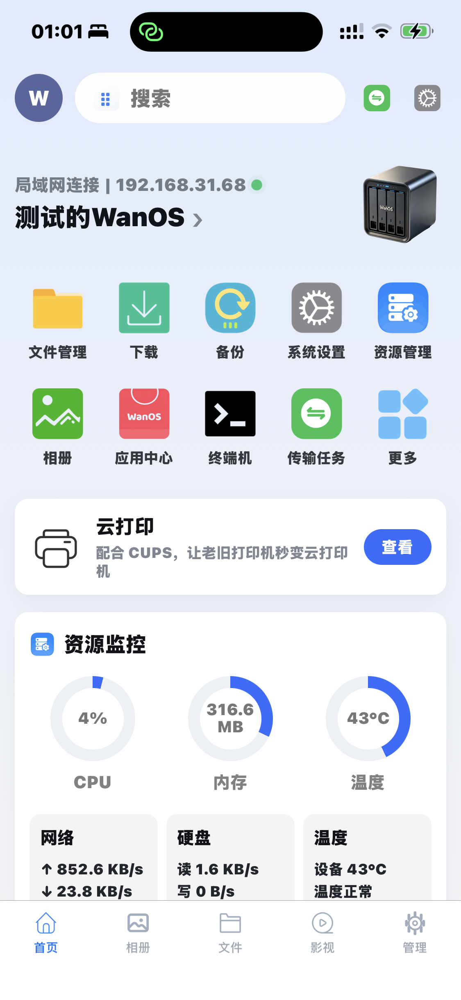
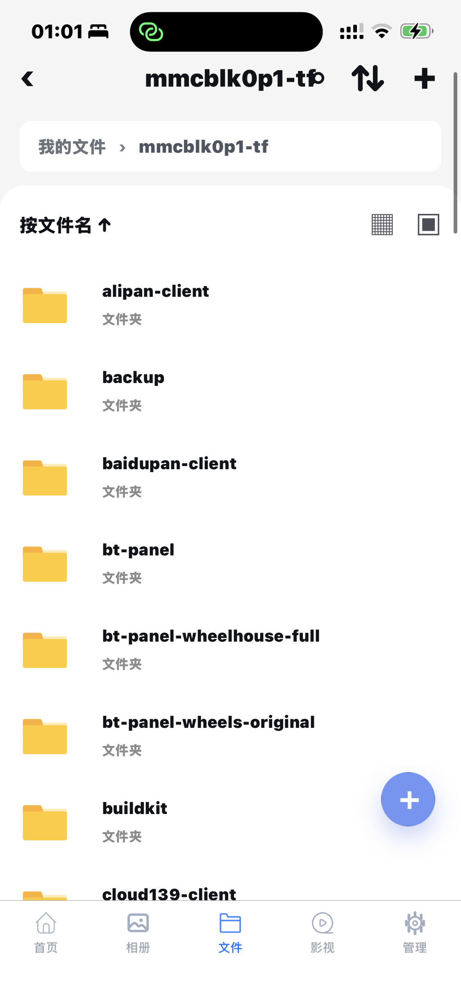
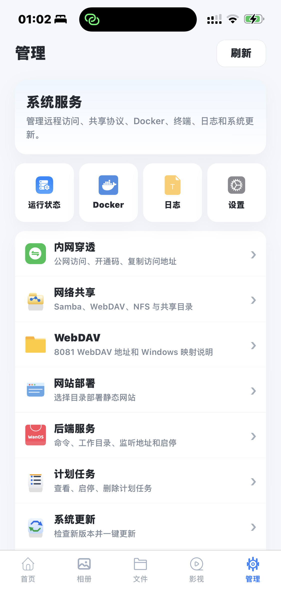
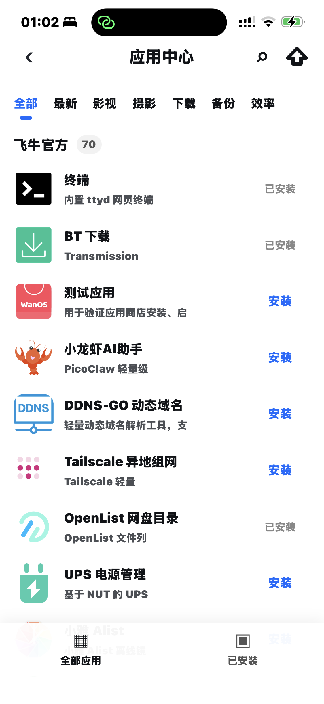
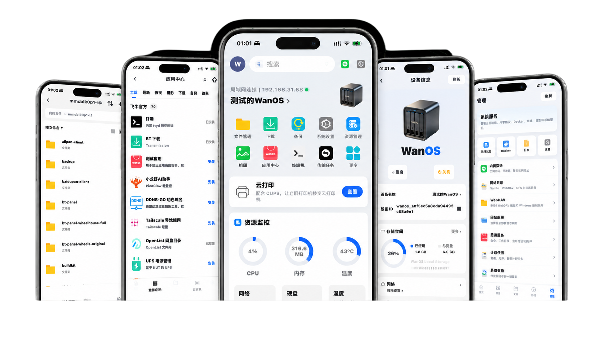
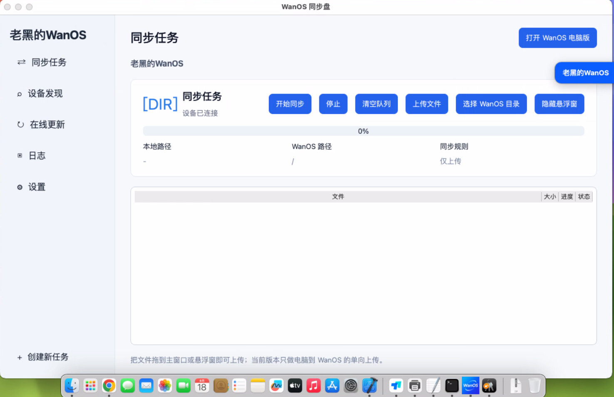
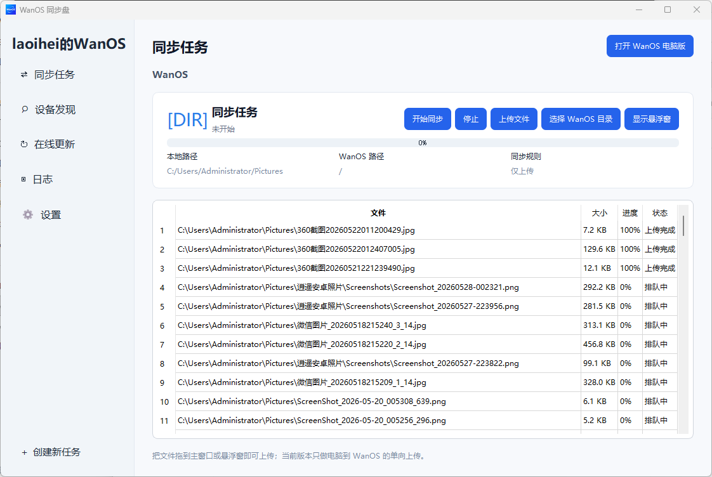

# WanOS APP 下载
https://github.com/aabacada/wankeyunwanos/releases/tag/v2026.11.5

> 手机版、电视端、电脑同步盘和苹果版入口统一整理。下载安装到手机或电视后，可连接局域网 IP、公网域名或自定义端口访问 WanOS。
>
> 整理自 <https://www.wanos.xyz/app/#download>，本地离线版生成于 2026-11-05，配图已下载到 `images/`。

| 项目 | 信息 |
| --- | --- |
| 页面来源 | <https://www.wanos.xyz/app/#download> |
| 适用设备 | Android 手机 / iPhone·iPad / 安卓电视与盒子 / HarmonyOS NEXT 5.0 / macOS / Windows 电脑 / 微信小程序 |
| 连接方式 | 局域网自动发现、IP、内网域名、公网域名、自定义端口 |
| 官方联系 | QQ 1546912750 |

---

## 目录

- [手机上连接和管理 WanOS](#手机上连接和管理-wanos)
- [下载入口](#下载入口)
  - [Android 手机版](#android-手机版)
  - [苹果版](#苹果版)
  - [电视端 APK](#电视端-apk)
  - [鸿蒙版](#鸿蒙版)
  - [Mac 版同步盘](#mac-版同步盘)
  - [WanOS 同步盘（电脑端）](#wanos-同步盘电脑端)
  - [微信小程序](#微信小程序)
- [APP 主要功能](#app-主要功能)
- [下载地址汇总](#下载地址汇总)
- [相关链接](#相关链接)

---

## 手机上连接和管理 WanOS

APP 面向局域网自动发现、一键连接、最近设备记忆，以及内网域名、公网域名和自定义端口访问。适合手机快速进入家里的 WanOS。

| 首页 | 文件 |
| --- | --- |
|  |  |

| 管理 | 应用 |
| --- | --- |
|  |  |

---

## 下载入口

WanOS APP 提供七个入口：安卓 App、苹果 App、TV 版、鸿蒙版、Mac 版同步盘、WanOS 同步盘（电脑端）和微信小程序。

> 安卓、TV、同步盘走网盘分发（夸克 / 移动云盘 / 迅雷任选其一）；苹果走 App Store；Mac 版是直接下载的 DMG；鸿蒙版需在华为应用商店搜索“玩OS”。

### Android 手机版

支持自动扫描局域网 WanOS、手动输入 IP、内网域名、公网域名和端口连接。

下载 Android APK（三选一）：

| 网盘 | 链接 |
| --- | --- |
| 夸克网盘 | <https://pan.quark.cn/s/cc465bedddc1> |
| 移动云盘 | <https://yun.139.com/shareweb/#/w/i/2v3EDXyoQkAkv> |
| 迅雷云盘 | <https://pan.xunlei.com/s/VOubjjG-Q-qcay_3CFSqiDJiA1?pwd=ckrj> |

### 苹果版

已上架 App Store。手机访问可直接打开，电脑访问可扫下面的二维码。

- App Store 地址：<https://apps.apple.com/cn/app/wanos/id6772852325>

### 电视端 APK

适合安卓电视和电视盒子，自动发现 WanOS 后读取视频、音乐、图片大屏播放。

下载 TV 版 APK（三选一）：

| 网盘 | 链接 |
| --- | --- |
| 夸克网盘 | <https://pan.quark.cn/s/298413675fe9> |
| 移动云盘 | <https://yun.139.com/shareweb/#/w/i/2v3EDRxXcBp66> |
| 迅雷云盘 | <https://pan.xunlei.com/s/VOubjbKNNh4ipyVoev9q72_VA1?pwd=vkyj> |

### 鸿蒙版

面向 HarmonyOS NEXT 5.0 的精简版 WanOS 助手，保留设备发现、设备信息、文件管理和相册同步。

> 仅支持鸿蒙 NEXT 5.0 系统。请在**华为应用商店搜索“玩OS”**安装，官方未提供 APK 网盘下载。

### Mac 版同步盘

适用于 macOS 的 WanOS 同步盘，支持连接 WanOS、选择本地目录、上传文件和查看同步进度。

- 直接下载：<https://wxqun988.vxjuejin.com/app-downloads/mac/WanOSSync-mac.dmg>

### WanOS 同步盘（电脑端）

电脑端同步工具，支持连接 WanOS、选择同步目录、拖入文件上传和查看传输进度。

下载 WanOS 同步盘（三选一）：

| 网盘 | 链接 |
| --- | --- |
| 夸克网盘 | <https://pan.quark.cn/s/cf4a4c417f4c> |
| 移动云盘 | <https://yun.139.com/shareweb/#/w/i/2v3EDNxHXSotq> |
| 迅雷云盘 | <https://pan.xunlei.com/s/VOubjp_WtBt3suaw-flk9V-ZA1?pwd=rxdm> |

### 微信小程序

无需安装 APP，微信内即可连接局域网 WanOS，查看设备状态、浏览文件、管理分享和远程访问状态。

*微信扫码进入 WanOS 小程序*

---

## APP 主要功能

**自动发现设备**
打开 APP 后扫描局域网内的 WanOS 服务，点选结果即可连接。

**记住最近设备**
保留最近连接记录，下一次打开可直接回到常用设备。

**多地址兼容**
支持 IP、内网传统域名、公网域名和自定义端口，适配不同网络环境。

**移动端入口**
手机上快速进入 WanOS Web 管理界面，适合查看文件和日常管理。

---

## 下载地址汇总

| 平台 | 下载方式 | 链接 |
| --- | --- | --- |
| Android | 夸克网盘 | <https://pan.quark.cn/s/cc465bedddc1> |
| Android | 移动云盘 | <https://yun.139.com/shareweb/#/w/i/2v3EDXyoQkAkv> |
| Android | 迅雷云盘 | <https://pan.xunlei.com/s/VOubjjG-Q-qcay_3CFSqiDJiA1?pwd=ckrj> |
| iOS / iPadOS | App Store | <https://apps.apple.com/cn/app/wanos/id6772852325> |
| 电视端 | 夸克网盘 | <https://pan.quark.cn/s/298413675fe9> |
| 电视端 | 移动云盘 | <https://yun.139.com/shareweb/#/w/i/2v3EDRxXcBp66> |
| 电视端 | 迅雷云盘 | <https://pan.xunlei.com/s/VOubjbKNNh4ipyVoev9q72_VA1?pwd=vkyj> |
| 鸿蒙 NEXT 5.0 | 华为应用商店搜“玩OS” | 无 APK，商店内安装 |
| macOS | 直接下载 DMG | <https://wxqun988.vxjuejin.com/app-downloads/mac/WanOSSync-mac.dmg> |
| 电脑同步盘 | 夸克网盘 | <https://pan.quark.cn/s/cf4a4c417f4c> |
| 电脑同步盘 | 移动云盘 | <https://yun.139.com/shareweb/#/w/i/2v3EDNxHXSotq> |
| 电脑同步盘 | 迅雷云盘 | <https://pan.xunlei.com/s/VOubjp_WtBt3suaw-flk9V-ZA1?pwd=rxdm> |
| 微信小程序 | 微信扫码 | 见上文`wanos-miniprogram-qr.jpg` |

---

## 相关链接

| 内容 | 链接 |
| --- | --- |
| APP 下载原页 | <https://www.wanos.xyz/app/> |
| 刷机教程（先刷入 WanOS） | <https://www.wanos.xyz/flash/> |
| 使用说明 | <https://www.wanos.xyz/doc.html> |
| 系统能力 | <https://www.wanos.xyz/system-capabilities/> |
| WPK 应用开发文档 | <https://www.wanos.xyz/docs/wpk/> |
| 发布你的 WPK 应用 | <https://www.wanos.xyz/app-store/publish/> |
| 成品设备 | <https://www.wanos.xyz/devices/> |
| 交流论坛 | <https://www.wanos.xyz/forum/> |
| 官方联系 QQ | 1546912750 |
