# 玩客云 S805 刷入 WanOS

> 本教程用于晶晨 S805 玩客云、赚 3、WS1608、OneCloud 机型。通过晶晨 USB Burning Tool 线刷 WanOS 镜像，刷机前请先备份重要数据。
>
> - 原文：<https://www.wanos.xyz/flash/>
> - 本地离线版整理时间：2026-11-05
> - 配图已下载到 `images/` 目录，断网也能看

---

## 目录

- [刷机风险提示](#刷机风险提示)
- [视频教程](#视频教程)
- [01 准备刷机工具](#01-准备刷机工具)
- [02 拆开玩客云外壳](#02-拆开玩客云外壳)
- [03 找到短接点](#03-找到短接点)
- [04 连接双公头 USB 线](#04-连接双公头-usb-线)
- [05 导入 WanOS 镜像](#05-导入-wanos-镜像)
- [06 短接上电并开始烧录](#06-短接上电并开始烧录)
- [07 启动 WanOS](#07-启动-wanos)
- [下载地址汇总](#下载地址汇总)
- [常见问题](#常见问题)

---

## 刷机风险提示

> ⚠️ 刷机会改写设备系统分区，可能导致数据清空或设备无法启动。请确认设备型号、镜像版本和操作步骤后再开始。

---

## 视频教程

**先看一遍视频教程，再开始刷机**

视频会演示玩客云刷机的关键流程，包括工具准备、短接识别、导入镜像和首次启动。建议新手先完整看完，再按下面图文步骤操作。

- B 站视频教程：<https://www.bilibili.com/video/BV191Vb6GEoA/?vd_source=09fb7d3841aa7ad33bc7a7dbc27e8930>

---

## 01 准备刷机工具

你需要一台 Windows 电脑、一根双公头 USB 线、玩客云电源、晶晨 `USB_Burning_Tool.exe`，以及 WanOS 的 `.burn.img` 线刷镜像。

- 双公头 USB 线用于连接电脑和玩客云主板。
- 烧录工具安装后，先确认驱动没有报错。
- WanOS 镜像下载后如果是压缩包，需要先完整解压。

| 项目 | 说明 |
| --- | --- |
| 系统环境 | Windows 电脑 |
| 连接线材 | 双公头 USB 线（USB-A 对 USB-A） |
| 供电 | 玩客云原装电源 |
| 烧录工具 | 晶晨 `USB_Burning_Tool.exe`（网页标注版本 v2.1.3） |
| 系统镜像 | WanOS 玩客云 S805 线刷包（`linux-armv7`，`.burn.img`） |

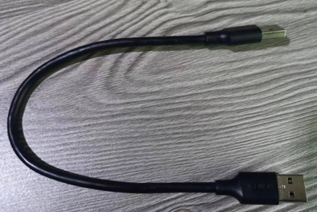

*双公头 USB 连接线*

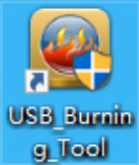

*USB Burning Tool*

---

## 02 拆开玩客云外壳

刷机通常需要取出主板进行短接。可以先用吹风机把背面的 PVC 贴片吹软，再用薄片沿缝隙慢慢撬开，避免硬掰损坏卡扣。

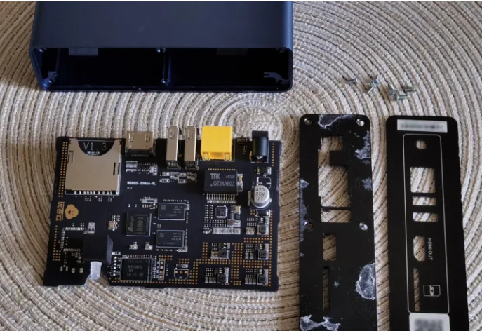

*取出主板后确认接口位置*

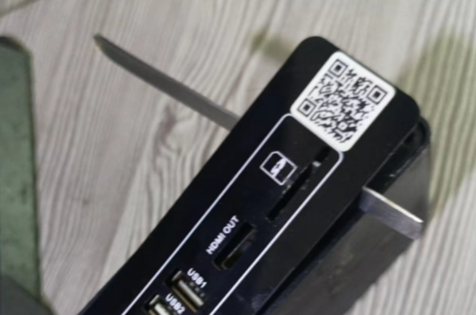

*不同批次主板细节可能不同*

---

## 03 找到短接点

不同玩客云主板的短接点可能不完全一样。下面图片是常见位置示例，如果你的板子不一致，请按板号继续确认短接点。

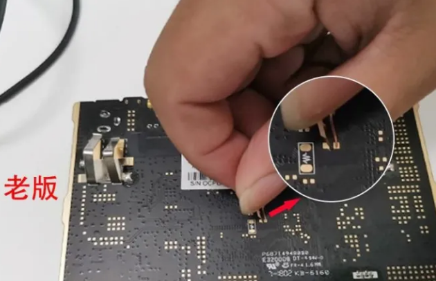

*短接点示例 1*

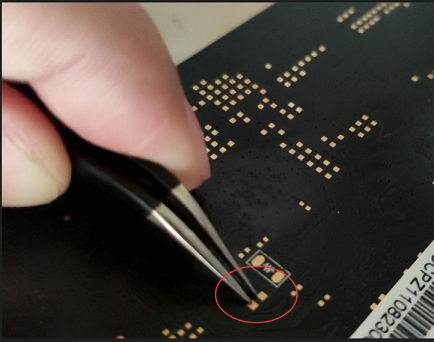

*短接点示例 2*

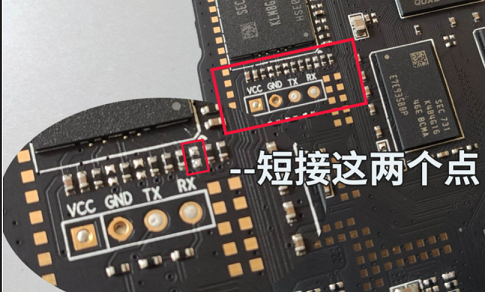

*短接点示例 3*

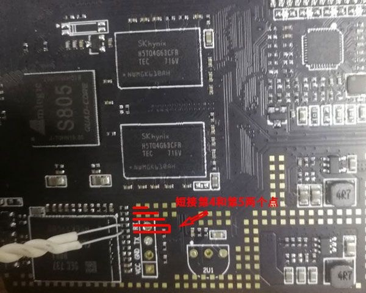

*短接点示例 4*

---

## 04 连接双公头 USB 线

USB 线一头接电脑，另一头接玩客云主板靠近 HDMI 一侧的 USB 口。先不要急着点开始，等烧录工具识别到设备后再操作。

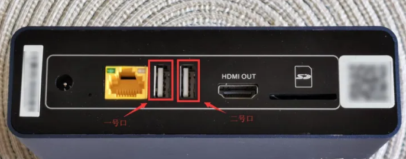

*连接靠近 HDMI 一侧的 USB 口*

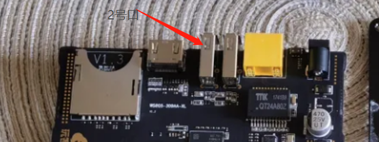

*确认线材插紧*

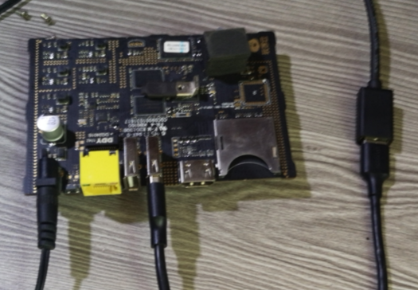

*等待工具显示已连接*

---

## 05 导入 WanOS 镜像

打开 `USB_Burning_Tool.exe`，选择“文件 / 导入烧录包”，导入解压后的 WanOS `.burn.img` 文件。导入完成后检查镜像名称是否正常。

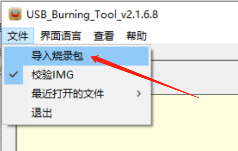

*导入 WanOS 线刷镜像*

---

## 06 短接上电并开始烧录

短接到位后给玩客云上电，工具显示“已连接”后松开短接点，点击“开始”。烧录期间不要拔线、断电或关闭工具，等待进度到 100%。

- 如果一直没有显示“已连接”，优先检查短接点、USB 口和驱动。
- 如果烧录失败，可以重新连接后再试，必要时再考虑全部擦除选项。
- 烧录成功后先点击“停止”，再拔掉双公头 USB 线。

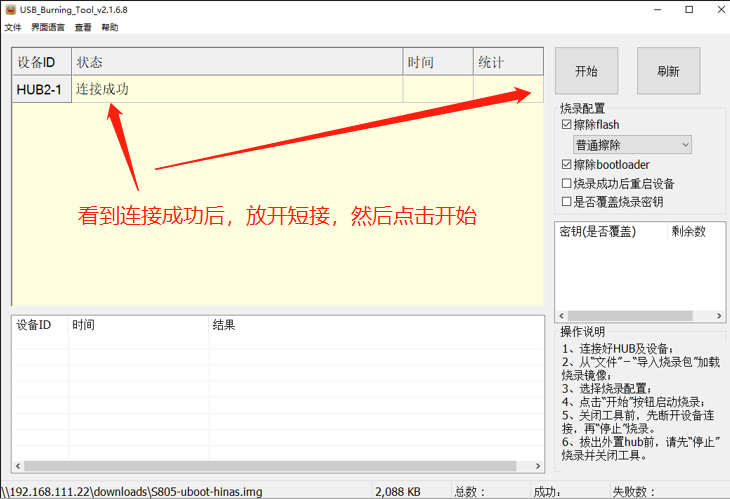

*设备已连接*

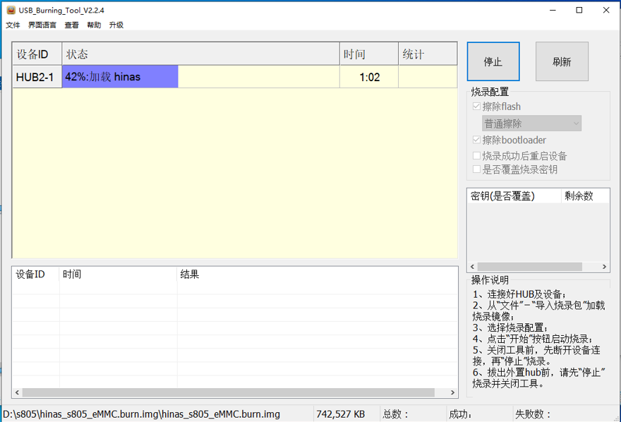

*点击开始烧录*

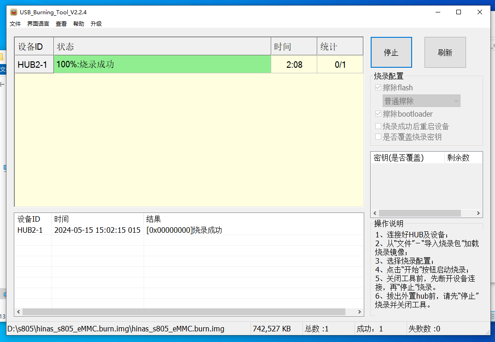

*等待进度完成*

---

## 07 启动 WanOS

拔掉双公头 USB 线，重新接入网线和电源。首次启动等待 2 到 3 分钟，然后到路由器后台查看玩客云获得的 IP 地址，在浏览器中打开即可进入 WanOS。

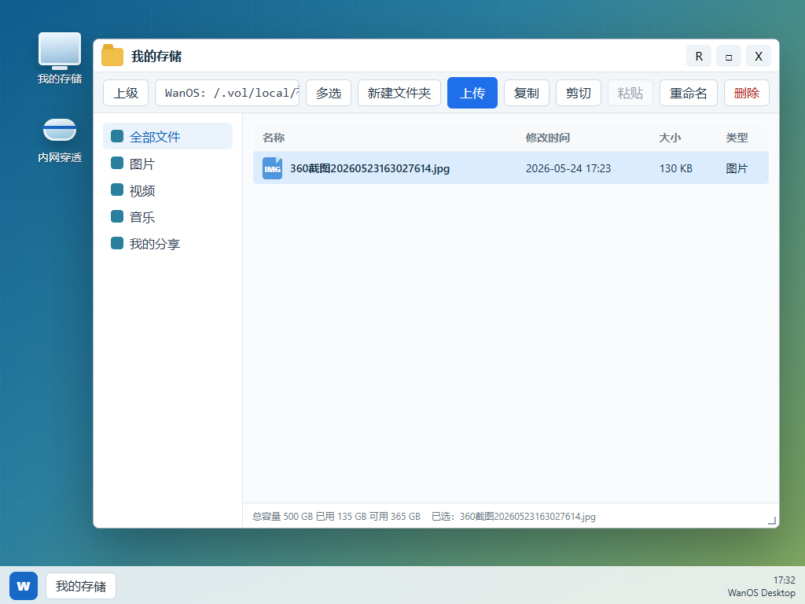

*刷机完成后，通过局域网 IP 访问 WanOS*

---

## 下载地址汇总

> 以下是抓取原文时页面实际指向的下载入口（原站用网盘分发，链接可能变更，失效时请回原页面 <https://www.wanos.xyz/flash/> 确认）。

### WanOS 玩客云 S805 线刷包（linux-armv7）

固定直链（页面接口返回）：

- 百度网盘：<https://pan.baidu.com/s/13Dv8TKz6_CQNQW8hR6ND-A?pwd=736k>

页面弹窗中提供的网盘入口（可能随版本更新变化）：

| 网盘 | 链接 |
| --- | --- |
| 移动云盘 | <https://yun.139.com/shareweb/#/w/i/2v3EK5X0mkJ1h> |
| 夸克网盘 | <https://pan.quark.cn/s/a42d0292c23a> |
| 迅雷云盘 | <https://pan.xunlei.com/s/VOu_bdtaZ-KZ4-HWy8YwvVIsA1?pwd=f6ba> |

### 最新手动更新包 · WanOS 0.3.427

已经刷入 WanOS 的用户，可以在系统设置的手动更新里上传此更新包，无需重新刷机。

- 版本：0.3.427（stable）
- 体积：40.5 MB（42,467,490 字节）
- SHA256：`2b7425b47c93862eb80df45a0c8b6b38a5270406e87f98c6c9c21d0b0ccdbf6f`
- 文件名：`wanos_update_v0.3.427_music_full_component_fix_20260810_linux-armv7.bin`
- 直链：<https://wxqun988.vxjuejin.com/wanos/up/wanos_update_v0.3.427_music_full_component_fix_20260810_linux-armv7.bin>

其他架构同版本（备用）：

| 架构 | 文件名 | 直链 |
| --- | --- | --- |
| linux-arm64 | `wanos_update_v0.3.427_music_full_component_fix_20260810_linux-arm64.bin` | <https://wxqun988.vxjuejin.com/wanos/up/wanos_update_v0.3.427_music_full_component_fix_20260810_linux-arm64.bin> |
| linux-amd64 | `wanos_update_v0.3.427_music_full_component_fix_20260810_linux-amd64.bin` | <https://wxqun988.vxjuejin.com/wanos/up/wanos_update_v0.3.427_music_full_component_fix_20260810_linux-amd64.bin> |

更新说明：

> WanOS 音乐前端改为首次使用时从七牛云下载完整组件，主程序不再内置音乐前端和独立 MacOS 前端；修复 Windows 生成的音乐组件 ZIP 在 Linux 设备上无法读取 JS、CSS 等资源，导致下载完成后一直显示加载中的问题。三架构 linux-armv7、linux-arm64、linux-amd64 同步发布。

更新包网盘入口（页面弹窗）：

| 网盘 | 链接 |
| --- | --- |
| 移动云盘 | <https://yun.139.com/shareweb/#/w/i/2v3EDNxJ75z8d> |
| 夸克网盘 | <https://pan.quark.cn/s/d86e22848129> |
| 迅雷云盘 | <https://pan.xunlei.com/s/VOu_vyLPdziwqM1mQ8MVF_bhA1?pwd=6vqs> |

### 烧录工具 / U 盘格式化工具

原文按钮为“下载 USB Burning Tool v2.1.3”，但点开弹窗后标题是“选择 U 盘格式化工具网盘”（原文文案前后不一致，请以实际网盘内容为准）。

| 网盘 | 链接 |
| --- | --- |
| 移动云盘 | <https://yun.139.com/shareweb/#/w/i/2v3EDxwAY6xz2> |
| 夸克网盘 | <https://pan.quark.cn/s/9b3c87b5e079> |
| 迅雷云盘 | <https://pan.xunlei.com/s/VOua-np0wzkhdqSl83kO2zo8A1?pwd=tj5s> |

---

## 常见问题

**Q：第二次刷机还需要短接吗？**

很多情况下不需要。插入靠近 HDMI 的 USB 口、打开烧录工具、重新上电后可能会直接显示已连接。如果无法识别，再按首次刷机流程短接。

**Q：刷机后找不到设备 IP 怎么办？**

先确认网线连接正常，路由器 DHCP 已开启。首次启动请等待 2 到 3 分钟，再查看路由器客户端列表。

**Q：以后更新 WanOS 还要重新刷机吗？**

不一定。WanOS 会把底层系统和应用层尽量分开，常规功能更新目标是通过系统内的一键更新完成，只有底层镜像变化较大时才需要重新刷机。

---

## 刷机失败，或者还没有合适的设备？

如果你不想拆机、短接、线刷，也可以看看已经预装 WanOS 的成品设备。开箱接网线和硬盘即可开始使用。

- 成品设备：<https://www.wanos.xyz/devices/>

> 商品由第三方卖家发布，WanOS 只做展示，不担保产品质量、售后和交易安全，请自行鉴别。

---

## 附录：相关链接

| 内容 | 链接 |
| --- | --- |
| 刷机教程原页 | <https://www.wanos.xyz/flash/> |
| WanOS 首页 | <https://www.wanos.xyz/> |
| 使用说明 | <https://www.wanos.xyz/doc.html> |
| 系统能力 | <https://www.wanos.xyz/system-capabilities/> |
| 交流论坛 | <https://www.wanos.xyz/forum/> |
| WPK 应用开发文档 | <https://www.wanos.xyz/docs/wpk/> |
| B 站视频教程 | <https://www.bilibili.com/video/BV191Vb6GEoA/> |
| 官方联系 QQ | 1546912750 |
